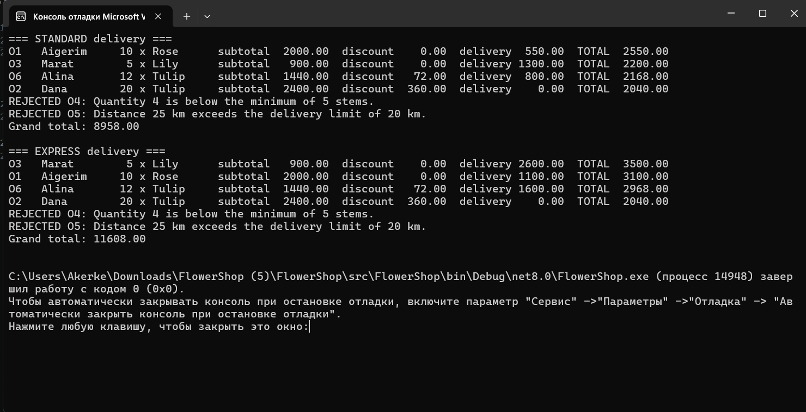

# Flower Shop – Order Quote Pipeline
## 1. Topic, users, team

- **Topic:** flower-shop orders.
- **Intended users:** the shop owner/florist, who loads a batch of orders and gets a priced quote for each, ranked by total.
- **Team:** Akerke Berdakul, IT - 2503

## 2. Workflow

Input file (CSV) -> parse and validate -> **Stage 1** select eligible orders -> **Stage 2** price orders (delivery policy supplied from outside) -> **Stage 3** build the quote summary -> print.

**Input fields** (`data/orders.csv`, first line is the header):

| Field | Rule |
| --- | --- |
| OrderId | required, unique |
| Customer | required |
| Flower | Rose, Tulip, Lily or Sunflower (case-insensitive) |
| Quantity | whole number > 0 |
| DistanceKm | whole number >= 0 (0 = pick-up in the shop) |
| IsMember | `true` or `false` |

**Business rules**

- Unit prices: Rose 200, Tulip 120, Lily 180, Sunflower 100.
- Minimum order: **5 stems** (5 is accepted, 4 is rejected).
- Maximum delivery distance: **20 km** (20 is accepted, 21 is rejected).
- Bulk discount: **10%** of the flower subtotal when quantity >= **20**.
- Member discount: **5%** of the flower subtotal. Bulk and member discounts add up.
- Delivery fee (the configurable rule, 0 km is always free):
  - **Standard policy:** 300 + 50 per km
  - **Express policy:** 600 + 100 per km
- Total = subtotal - discount + delivery fee. Quotes are sorted by total (highest first), then by OrderId.

## 3. Dataset and expected results (written before running)

| Id | Customer | Flower | Qty | Km | Member | Purpose |
| --- | --- | --- | --- | --- | --- | --- |
| O1 | Aigerim | Rose | 10 | 5 | no | normal; delivery differs per policy |
| O2 | Dana | Tulip | 20 | 0 | yes | bulk boundary (20), pick-up (0 km), 15% discount |
| O3 | Marat | Lily | 5 | 20 | no | boundary: min quantity and max distance, accepted |
| O4 | Sara | Sunflower | 4 | 3 | no | rejected: quantity below 5 |
| O5 | Timur | Rose | 8 | 25 | no | rejected: distance above 20 km |
| O6 | Alina | Tulip | 12 | 10 | yes | member discount |

**Standard policy**

| Order | Subtotal | Discount | Delivery | Total |
| --- | --- | --- | --- | --- |
| O1 | 2000 | 0 | 550 | **2550** |
| O3 | 900 | 0 | 1300 | **2200** |
| O6 | 1440 | 72 | 800 | **2168** |
| O2 | 2400 | 360 | 0 | **2040** |

Grand total **8958**. Rejected: O4, O5.

**Express policy**

| Order | Subtotal | Discount | Delivery | Total |
| --- | --- | --- | --- | --- |
| O3 | 900 | 0 | 2600 | **3500** |
| O1 | 2000 | 0 | 1100 | **3100** |
| O6 | 1440 | 72 | 1600 | **2968** |
| O2 | 2400 | 360 | 0 | **2040** |

Grand total **11608**. Rejected: O4, O5. The ranking changes: O1 is first under Standard, O3 is first under Express.

## 4. Pipeline stages (`src/FlowerShop/OrderPipeline.cs`)

| Stage | Method | Input -> Output | Rule | Example |
| --- | --- | --- | --- | --- |
| 1 | `SelectEligible` | `ImmutableArray<Order>` + `ShopRules` -> `SelectionResult` | Keep Quantity >= 5 and DistanceKm <= 20; the rest get a rejection reason | O3 (5 stems, 20 km) is kept; O4 (4 stems) is rejected |
| 2 | `PriceOrders` | `SelectionResult` + `ShopRules` + `Func<Order, decimal>` -> `PricingResult` | subtotal = qty x unit price; discount = subtotal x (bulk + member rate); delivery fee from the delegate | O6: 1440 - 72 + 800 = 2168 (Standard) |
| 3 | `BuildSummary` | `PricingResult` -> `QuoteSummary` | Sort by total desc, then id; sum the grand total | Standard: O1, O3, O6, O2; total 8958 |

`OrderPipeline.Run` composes them with the small helper `Then`:
`orders.Then(SelectEligible).Then(PriceOrders).Then(BuildSummary)` (written with lambdas in the code).

**Trace of O6** (Alina, Tulip, 12, 10 km, member): `Order` -> stage 1 accepts it (12 >= 5, 10 <= 20) -> stage 2 creates `PricedOrder(subtotal 1440, discount 72, fee 800)` -> stage 3 creates `Quote(..., Total 2168)`.

**Higher-order function:** `PriceOrders` takes `Func<Order, decimal> deliveryPolicy` and calls it with `deliveryPolicy(order)`. The policies are in `DeliveryPolicies.cs` (`Standard`, `Express`, built by `FlatPlusPerKm`, which captures two immutable numbers). `Program.cs` chooses the policy and passes it in; there is no mutable global setting.

**Purity:** stages only read their arguments and return new immutable values (records and `ImmutableArray`). No Console, files, clock or random values are used inside them. File reading and printing happen only in `Program.cs`.

## 5. Requirement -> code map

| Requirement | Where |
| --- | --- |
| Typed immutable models | `Models.cs` (records) |
| Parsing and validation at the boundary | `OrderParser.cs` (`TryParse`, `ParseAll`) |
| Three pure stages and composition | `OrderPipeline.cs` (`SelectEligible`, `PriceOrders`, `BuildSummary`, `Run`) |
| Higher-order function and two policies | `PriceOrders`, `DeliveryPolicies.cs` |
| Policy chosen outside the pipeline | `Program.cs` |
| Output kept outside the core | `ReportFormatter.cs`, `Program.cs` |
| Tests | `tests/FlowerShop.Tests/OrderPipelineTests.cs` |

## 6. Build, run, test

- **Prerequisite:** .NET SDK 8.0 or newer. Working directory: the folder containing `FlowerShop.sln`.

```
dotnet build
dotnet run --project src/FlowerShop -- data/orders.csv
dotnet run --project src/FlowerShop -- data/orders_invalid.csv
dotnet run --project src/FlowerShop -- data/orders_empty.csv
dotnet test
```

- `orders.csv`: both policies, results as in section 3.
- `orders_invalid.csv`: prints one message per bad line (unknown flower, non-numeric quantity, missing customer, negative distance, wrong field count, bad boolean), then still prices the valid order B1 (Standard 2550, Express 3100). Exit code 2.
- `orders_empty.csv`: header only = valid empty dataset; prints "no orders", no quotes, grand total 0.00.

## 7. Tests (xUnit: 40 test methods = 54 cases counting theory rows; 26 for the pipeline, 28 for Assignment 6 – see section 9.8)

| Required case | Tests |
| --- | --- |
| Normal workflow | `NormalWorkflow_StandardPolicy_...`, `NormalWorkflow_ExpressPolicy_...` |
| Empty dataset | `EmptyDataset_ParsesAsValidEmptyBatch`, `EmptyDataset_ProducesEmptySummary...` |
| Boundary value | `Boundary_ExactMinimum...`, `Boundary_JustOutsideLimits...`, `Boundary_BulkThreshold...` |
| Invalid and missing input | `InvalidOrMissingLine_...` (9 rows), `ZeroDistanceAndFalseMembership...`, `ParseAll_ReportsLineNumbers...`, `MissingCollections_AreRejected` |
| Two policies | `TwoPolicies_SameInput_...`, `HigherOrderStage_InvokesTheSuppliedDelegate...`, `PolicyReturningNegativeFee...` |
| Purity and stages | `Stage1_...DoesNotChangeCallerOwnedInput`, `Stage2_...`, `Stage3_...`, `SameInputAndPolicy_...` |


### 9.1 Workflow, input, output

- **Input:** `data/inventory.csv` (`Flower,Stock`) and `data/quote_requests.csv` (same columns as the orders file).
- **Chain** (`QuoteWorkflow.RequestQuote`, pure code, no files, no Console):
  `inventory.Find` (Maybe) -> `ToResult` -> `Bind(CheckRequest)` -> `Bind(PriceWithPipeline)` -> `Map(QuoteDisplay.From)`
- **Boundary** (`QuoteCommand`): loads both files, runs the chain for each request, and handles every final outcome once with `Match`.

### 9.2 What each type means

| Type | Meaning |
| --- | --- |
| `Result<T, AppError>` | The operation either succeeded with a value or failed in an expected way. A success always has a value; a failure always has an error. |
| `AppError(Kind = Domain, ...)` | A **validation failure**: a shop rule rejected this request (an expected business outcome). |
| `AppError(Kind = Operational, ...)` | The **environment** failed: the file is missing, unreadable or malformed. |
| `Maybe<T>` (`Some` / `None`) | The answer to a **lookup**: the item is there or it is not. It is not an error by itself. |
| Workflow state | `Draft`-style stages are not used here; the stages of Assignment 4 (`SelectionResult`, `PricingResult`, `QuoteSummary`) are the state of the pipeline. |

`Maybe.None` becomes a `Result` failure only because this workflow requires the item (`ToResult`). A flower with **stock 0 is `Some`**: it exists and is sold out, which gives `insufficient_stock`, not `flower_not_found`.

### 9.3 Expected results and errors

| Case | Example request | Result | Error code and message |
| --- | --- | --- | --- |
| Success | Q1: 10 Rose, 5 km, not a member | success, total 2550.00 | – |
| Invalid quantity (domain) | Q2: 4 Rose | failure | `quantity_below_minimum`: "Order Q2: quantity 4 is below the minimum of 5 stems." |
| Missing item (domain) | Q5: Tulip, not in the inventory | failure | `flower_not_found`: "Order Q5: Tulip is not stocked." |
| State does not permit (domain) | Q3: 10 Lily, only 8 in stock | failure | `insufficient_stock`: "Order Q3: only 8 Lily in stock, 10 requested." |
| Distance (domain) | Q6: 10 Rose, 25 km | failure | `distance_too_far`: "Order Q6: distance 25 km exceeds the delivery limit of 20 km." |
| Present, zero stock | Q4: 5 Sunflower, stock 0 | failure | `insufficient_stock` (the flower is found, not absent) |
| Boundary success | Q7: 5 Lily, 20 km, member | success, total 2155.00 | – |
| Missing file (operational) | `data/does_not_exist.csv` | failure | `file_not_found`: "The inventory file '...' was not found." |
| Malformed file (operational) | `data/inventory_malformed.csv` | failure | `malformed_content`: "Inventory file '...' is malformed: Line 3: ... Line 4: ..." |

### 9.4 Demonstrations (working directory: the folder with `FlowerShop.sln`)

```
dotnet run --project src/FlowerShop -- quote data/inventory.csv data/quote_requests.csv
dotnet run --project src/FlowerShop -- quote data/does_not_exist.csv data/quote_requests.csv
dotnet run --project src/FlowerShop -- quote data/inventory_malformed.csv data/quote_requests.csv
dotnet run --project src/FlowerShop -- data/orders.csv      # the earlier pipeline, still active
```

Expected output of the first command (standard delivery policy):

```
Loaded 3 stock lines and 7 quote requests.

OK      Q1: 10 x Rose for Aigerim = 2550.00 (subtotal 2000.00, discount 0.00, delivery 550.00)
FAILED  [quantity_below_minimum] Order Q2: quantity 4 is below the minimum of 5 stems.
FAILED  [insufficient_stock] Order Q3: only 8 Lily in stock, 10 requested.
FAILED  [insufficient_stock] Order Q4: only 0 Sunflower in stock, 5 requested.
FAILED  [flower_not_found] Order Q5: Tulip is not stocked.
FAILED  [distance_too_far] Order Q6: distance 25 km exceeds the delivery limit of 20 km.
OK      Q7: 5 x Lily for Aibek = 2155.00 (subtotal 900.00, discount 45.00, delivery 1300.00)
```

The second command prints `ERROR (Operational) [file_not_found] ...` and the third prints `ERROR (Operational) [malformed_content] ...` with the bad line numbers. Both exit with code 1 and process no request.

**Running from Visual Studio:** the program starts in `bin/Debug/net8.0`. A relative path such as `data/orders.csv` that is not found there is searched in the parent folders (`DataPaths.Resolve`), so the files in the project's `data` folder are found without copying them. For the quote workflow set the debug arguments (Project properties > Debug > command line arguments) to `quote`, or to `quote data/inventory.csv data/quote_requests.csv`.

### 9.5 Where Map and Bind are used (and why their return types differ)

- `Bind(item => CheckRequest(...))` and `Bind(order => PriceWithPipeline(...))`: the next step **may itself fail**, so it returns a `Result`; `Bind` keeps that `Result` as it is.
- `Map(quote => QuoteDisplay.From(quote))`: the last step **cannot fail** and returns a plain value; `Map` wraps it in a success.
- On a failure both skip the supplied function and pass the same error on. Proof: `FailurePropagation_MapAndBind_...` (counters stay 0) and `FailurePropagation_MissingItem_SkipsValidationAndPricing` (the delivery policy delegate is never called).
- `QuoteCommand` also uses `Bind` and `Map` to combine "inventory loaded" and "requests loaded".

### 9.6 Exception boundary and consistent state

- `FileBoundary.ReadLines` is the **only** place that touches the file system. It catches `FileNotFoundException`, `DirectoryNotFoundException`, `UnauthorizedAccessException`, `IOException` and invalid-path exceptions, and returns an Operational failure that names the file. There is no empty catch and no fallback.
- `InventoryLoader.Parse` and `RequestLoader.Parse` are pure. Parsing is **all-or-nothing**: one bad line gives one failure and no `Inventory` object, so nothing is partially loaded. `Inventory` and `Result` are immutable, so a failed load cannot change data loaded earlier (test `MissingFile_..._StateStaysConsistent`).
- The domain workflow never throws for business failures; they are `Result` failures.

### 9.7 Requirement -> code map

| Requirement | Where |
| --- | --- |
| Result type, no contradictory states | `Result.cs` (private constructor, private case classes, `Ok` / `Fail` reject null) |
| At least three domain failures | `QuoteWorkflow.CheckRequest`, `Maybe.ToResult` in `RequestQuote` |
| Structured error | `AppError.cs` |
| Missing value model and real lookup | `Maybe.cs`, `Inventory.Find` |
| Map and Bind, one real chain | `ResultExtensions` in `Result.cs`, `QuoteWorkflow.RequestQuote` |
| Final outcome handled once at the boundary | `QuoteCommand.Run` (`Match`) |
| File exceptions at the boundary | `FileBoundary.cs`, `InventoryLoader.Load`, `RequestLoader.Load` |
| Earlier pipeline stays active | `QuoteWorkflow.PriceWithPipeline` calls `OrderPipeline.Run` |

### 9.8 Tests for Assignment 6 (`tests/FlowerShop.Tests/ResultWorkflowTests.cs`, 20 methods)

| Required case | Tests |
| --- | --- |
| Complete success | `CompleteSuccess_ChainProducesTheCorrectDisplayModel` (total 2550) |
| Domain failures | `DomainFailure_QuantityBelowMinimum_...`, `..._FlowerNotStocked_...`, `..._InsufficientStock_...`, `..._DistanceTooFar_...` |
| Lookup present and absent | `Lookup_PresentAndAbsent_AreBothHandled`, `Lookup_ZeroStock_IsPresentData_NotAbsence`, `LegitimatePrimitiveValues_...`, `Quote_WithMemberFalse_...` |
| Map success | `Map_Success_ReceivesTheValueAndReturnsTheTransformedValue` |
| Bind success | `Bind_Success_ReceivesTheValueAndKeepsTheNextResult` |
| Failure propagation | `FailurePropagation_MapAndBind_...`, `FailurePropagation_MissingItem_SkipsValidationAndPricing` |
| Missing file | `MissingFile_IsReportedAsOperationalFailure_AndStateStaysConsistent`, `MissingFile_BlankPath_...` |
| Malformed file | `MalformedFile_BecomesOneClearFailure_...`, `MalformedContent_InMemory_...` (7 rows), `RequestFile_ValidAndMalformed_...` |
| Integration | `ValidInventoryContent_WithZeroStock_...`, `Integration_LoadedFiles_FlowThroughTheWholeChain` |

File tests write to a temporary folder (`Path.GetTempPath()` + a new GUID) and delete it afterwards. Together with the 18 pipeline tests plus `DataPathsTests.cs` (2 tests for the file path lookup), the project has 40 test methods (54 cases).

**Latest test outcome:** 
